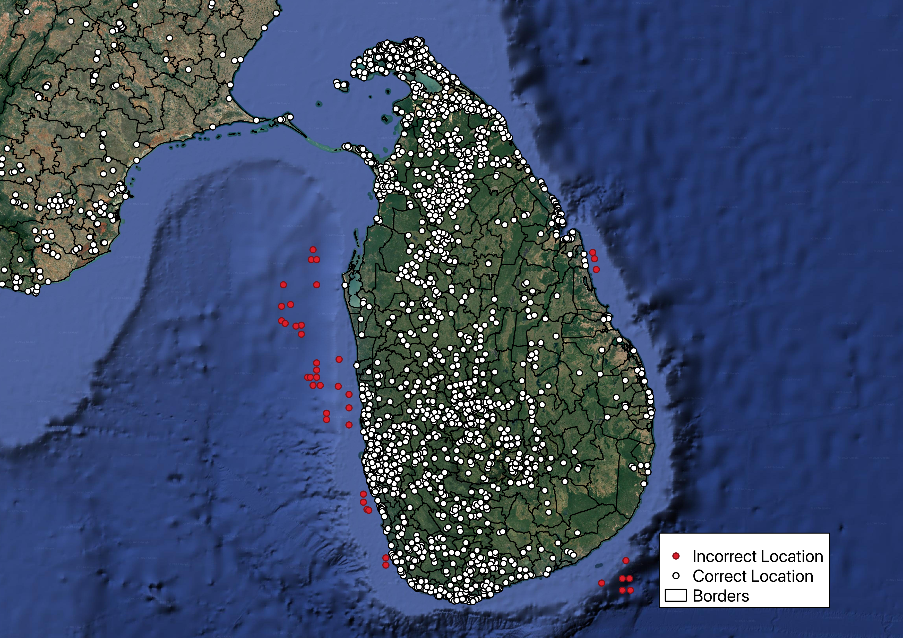

# Data validation

Every file you upload is passed through an automated validation and standardisation pipeline before it is used in any analysis. The pipeline is category-aware: the checks applied to a point-of-interest file are not the same as those applied to a mobile coverage raster.

The pipeline applies corrections to rescue an imperfect file, for example by correcting accented or inconsistent column headings, alternative spellings of a technology or a non-WGS84 projection. However, a dataset only reaches the models once it contains at least one record that satisfies every mandatory requirement for its category.

## Column and value harmonisation

Column names are normalised before any other check: converted to lower case, stripped of accents and punctuation, with spaces converted to underscores (`Latitud Geográfica` → `latitud_geografica`). A dictionary of known aliases is then applied, so common exports work without manual editing. For example `latitude`, `latitud` → **`lat`**; `antenna_height_m` → **`antenna_height`**; `internet_availability` → **`is_connected`**.

Values in controlled-vocabulary fields are mapped onto the levels documented in [Input Datasets](inputdata.md) — for example `LTE` → **`4G`** and `NR` → **`5G`** for `radio_type`, `FTTx` → **`fiber`** for `connectivity_type`, and `Yes`/`No`/`1`/`0` → **`True`**/**`False`** for the boolean fields.

## Schema enforcement

- Any **mandatory or optional column that is absent** is created and populated with nulls, so that downstream models always receive a consistent schema.
- **Additional columns you supply are preserved**, not discarded, and travel through to the outputs.
- A **`dataset_id`** is generated for the upload, and a unique identifier (`poi_id` for points of interest, `ict_id` for cell sites and transmission nodes) is generated for every record.
- **`country_code`** is set to the ISO 3166-1 alpha-3 code of the country selected for the analysis.
- For points of interest, any column that holds **results from a previous CPP analysis** (distances to infrastructure, coverage flags, cost and revenue fields, fibre path variables, and around 70 others) is stripped out. This means you can safely re-upload a CPP output file as an input without stale results contaminating the new analysis.

## Geospatial validation

This is the most extensive part of the pipeline, and it applies to every category.

| Check | Behaviour |
|-------|-----------|
| Coordinate reference system | A file with no declared CRS is assumed to be **WGS84 (EPSG:4326)**. A file in any other CRS is **reprojected to WGS84** automatically. |
| Geometry validity | Every geometry is tested for being null, empty or topologically invalid (e.g. self-intersecting polygons). Invalid geometries are flagged and set to null rather than being allowed into the analysis. |
| Geometry from text | CSV and Excel files are scanned for a `geometry`, `wkt`, `geom_wkt`, `geometry_wkt` or `as_wkt` column and parsed into real geometry, so coverage polygons can be supplied as text. |
| Coordinate extraction | For point categories supplied as vector files, `lat`/`lon` are derived from the geometry — directly for `POINT`, and from the centroid for `MULTIPOINT`. |
| Coordinate plausibility | `lat` and `lon` are coerced to numbers; anything that is not numeric, or that falls outside the valid range of **−90 to 90** and **−180 to 180**, is treated as missing. Records still missing coordinates are removed. |
| Country boundary check | The country's administrative boundary is retrieved from a world boundaries reference dataset, buffered in a locally estimated UTM projection, and every point is spatially joined against it. Points falling outside are removed. |
| Deduplication | Exact geographic duplicates are removed — by coordinates for points of interest and transmission nodes, and by coordinates **and** `radio_type` for cell sites, so a co-located 4G and 5G site is correctly kept as two records. |

Coordinate errors are rarely obvious in a spreadsheet, but they are unmistakable on a map. Swapped, truncated or mistyped coordinates typically land in the sea:

*Points in red fall outside the buffered national boundary and are removed; points in white are kept.*

Mobile coverage rasters are validated separately: the file must open as a valid raster, contain **exactly one band**, declare a **coordinate reference system**, and have positive width and height. A **`radio_type`** must also be selected in the interface — a raster without one is rejected, because the coverage layer could not otherwise be attributed to a technology.

## Gap filling and imputation

Where a non-essential value is missing, the platform fills it using a documented rule rather than dropping the record.

### Points of interest

| Field | Rule |
|-------|------|
| `is_connected`, `connectivity_type` | If **both** are absent, connectivity is inferred by spatially joining each point against [Ookla Open Data](https://www.ookla.com/ookla-for-good/open-data) performance tiles. A point intersecting a fixed tile is classified as fixed — then as `fiber` or `adsl` depending on whether the measured average download speed reaches **100 Mbps** — a point intersecting only a mobile tile as `mobile`, and a point intersecting neither as not connected. The test is all-or-nothing: if either column contains **any** data, the inference is skipped for the whole dataset and the remaining nulls are left as they are. |
| `has_electricity` | Assumed `False` if not supplied. |
| `number_of_users` | Estimated from population data in the demand analysis. |
| `total_mbps` | Estimated from the number of users and the assumed bandwidth demand per user. |

### Cell sites

| Field | Rule |
|-------|------|
| `antenna_height` | Values above **1,000 m** are treated as data-entry errors and discarded. If your file contains **no usable heights at all** — the column is absent, empty or entirely non-numeric — every site is assigned the default of **25 m**. If it contains *some* valid heights, the missing ones are filled with the **median of the valid heights in your own file** rather than the default. |
| `radio_type` | Values outside `2G`/`3G`/`4G`/`5G` are set to `unknown` rather than guessed. Records with no `radio_type` at all are removed. |

### Transmission nodes

| Field | Rule |
|-------|------|
| `transmission_medium` | Values that are missing, or outside `coaxial`, `copper`, `microwave` and `fiber`, are set to `unknown`. |

### Mobile coverage

| Field | Rule |
|-------|------|
| `radio_type` | Values outside `2G`/`3G`/`4G`/`5G` are treated as missing, and the record is removed — coverage cannot be modelled without a technology. For rasters, the `radio_type` chosen in the interface is applied to the whole layer. |
